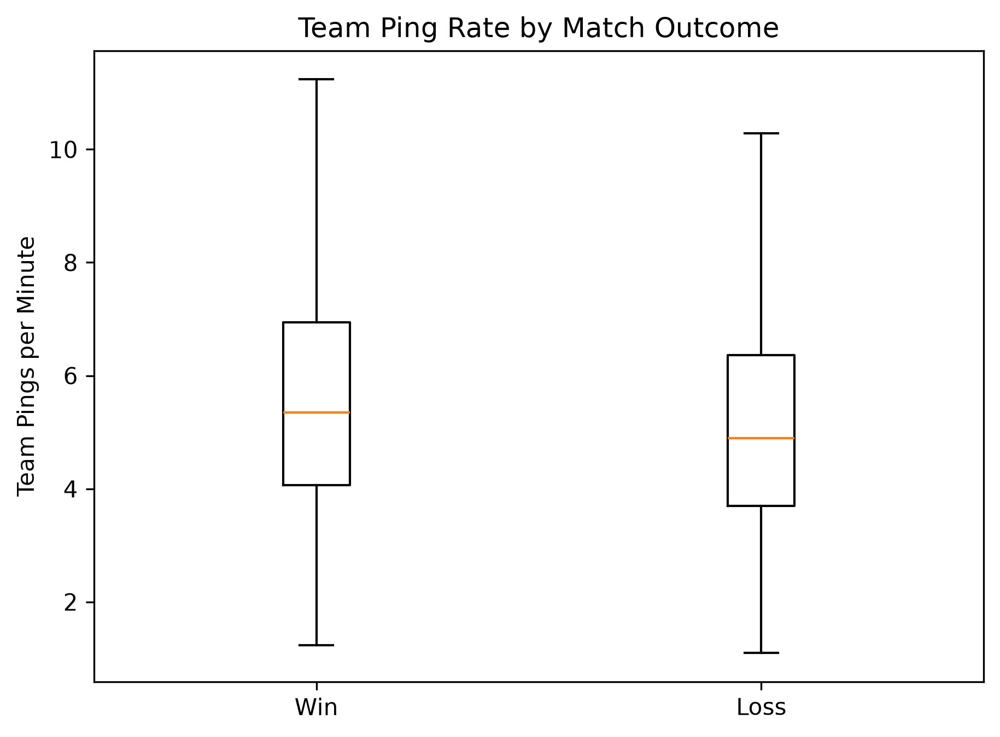
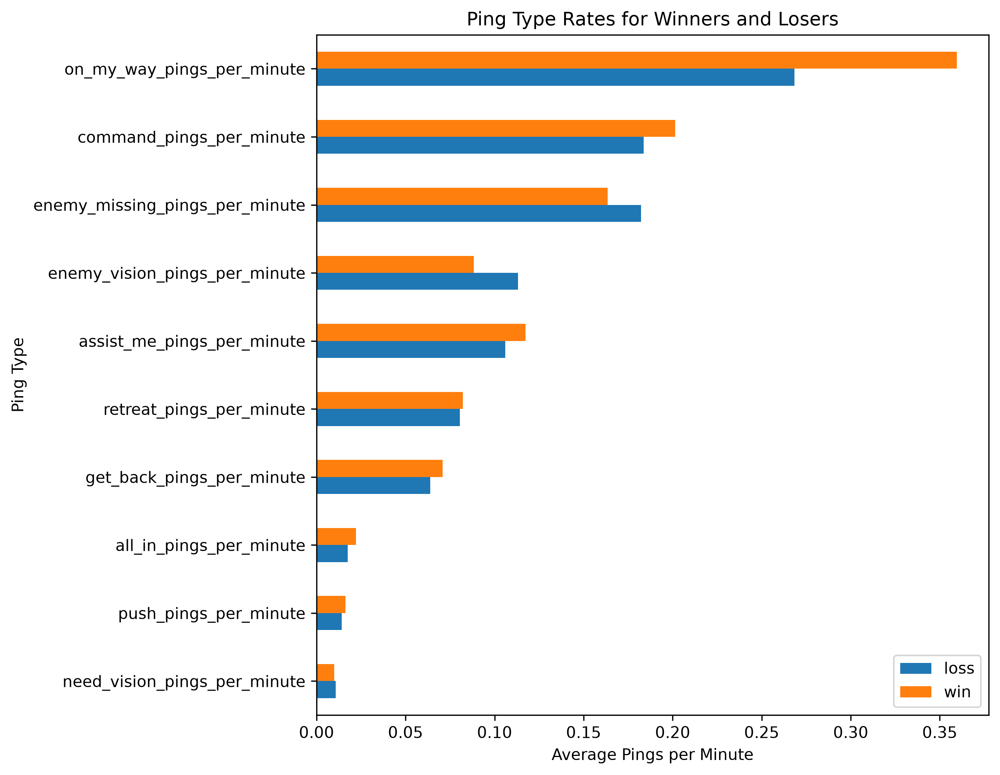

# League of Legends Ping Analysis

## Overview

Toxicity is a common issue in League of Legends, and one behavior often associated with it is excessive pinging. Although pings are intended to help players communicate quickly without typing, they can also be used to express frustration or criticize teammates. This made me curious about whether excessive pinging is actually associated with worse player performance and lower chances of winning.

I was particularly interested in `enemy_missing` pings, which appear as question marks in the game. While they're meant to warn teammates about missing enemies, players sometimes spam them after a teammate makes a mistake. I also examined `enemy_vision` pings, which are normally used to communicate information about enemy vision. Although their connection to toxicity is less direct, I wanted to see whether unusually high usage of these pings showed similar patterns.

My initial hypothesis was that players who ping excessively, especially those who frequently use `enemy_missing` pings, would tend to perform worse and lose more often. However, the results were more complicated than I expected. **Higher overall ping frequency was associated with winning, while unusually high usage of `enemy_missing` and `enemy_vision` pings was associated with lower win rates.**

Because the dataset only contains aggregated ping counts, I cannot determine whether individual pings were used with toxic intent. Instead, this project examines how ping frequency and type relate to player performance and match outcomes, rather than attempting to measure toxicity directly.

## Dataset

I used the [League of Legends Match Data dataset](https://huggingface.co/datasets/BoostedJonP/league_of_legends_match_data) from Hugging Face.

After cleaning and filtering the data to ranked Solo/Duo matches, the final dataset contained:

- **1,193 matches**
- **11,930 player-match observations**
- **2,386 team-match observations**

Each match contains information about ten players, including their roles, performance statistics, match outcomes, and counts of different ping types.

I examined performance measures such as kills, deaths, assists, KDA, gold earned, damage dealt, vision score, and creep score (CS).

## Methodology

The project was completed in five Jupyter notebooks, covering data collection, cleaning, feature engineering, exploratory analysis, and statistical testing.

| Notebook | Description |
|---|---|
| [01_data_download.ipynb](notebooks/01_data_download.ipynb) | Downloading and inspecting the original dataset |
| [02_data_audit_cleaning.ipynb](notebooks/02_data_audit_cleaning.ipynb) | Checking data quality, removing duplicates, and filtering matches |
| [03_feature_engineering.ipynb](notebooks/03_feature_engineering.ipynb) | Creating player-level and team-level features |
| [04_exploratory_analysis.ipynb](notebooks/04_exploratory_analysis.ipynb) | Exploring ping patterns across roles, performance measures, and match outcomes |
| [05_statistical_analysis.ipynb](notebooks/05_statistical_analysis.ipynb) | Testing relationships using statistical tests and regression models |

### Data Processing and Feature Engineering

I used Python, pandas, and NumPy to clean the data and create features for analysis.

Because matches vary in length, I calculated ping rates per minute instead of relying only on total ping counts. I also created team-level features to compare winning and losing teams within the same match.

Since different roles have different responsibilities and communication patterns, I accounted for player role when examining unusually high ping activity.

### Statistical Analysis

After exploring the data through visualizations, I used several statistical methods to investigate the relationships more closely:

- **Paired hypothesis tests:** Compared winning and losing teams within the same match.
- **Logistic regression:** Examined how ping activity was associated with the odds of winning.
- **Linear regression:** Examined relationships between ping activity and individual performance measures.
- **Role adjustments:** Accounted for differences in typical ping behavior between player positions.
- **Match-clustered standard errors:** Accounted for observations from players in the same match.
- **Benjamini–Hochberg correction:** Adjusted p-values when testing multiple relationships.

The analysis was conducted using SciPy and statsmodels, with Matplotlib and Seaborn used for visualizations.

## Key Findings

### 1. Winning teams tended to ping more frequently

Contrary to my initial expectation, winning teams had higher overall ping rates than losing teams.

| Match outcome | Average pings per minute |
|---|---:|
| Winning teams | 5.658 |
| Losing teams | 5.202 |

The difference was statistically significant (paired Wilcoxon test, p = 1.49 × 10⁻⁷).

Players in the top 10% of overall ping activity also had approximately **16.7% higher odds of winning** after accounting for player role (odds ratio = 1.167; 95% CI: 1.031–1.322).

These results suggest that frequent pinging is not necessarily associated with worse outcomes.



### 2. Ping types showed different relationships with match outcomes

Although winning teams pinged more overall, the distribution of ping types differed between winning and losing teams.

| Ping type | Winning teams | Losing teams |
|---|---:|---:|
| `on_my_way` | 31.40% | 25.23% |
| `enemy_missing` | 14.93% | 18.27% |
| `enemy_vision` | 7.89% | 10.96% |

*Percentages represent each ping type's share of a team's total pings.*

The `on_my_way` ping accounted for a larger share of winning teams' communication, while `enemy_missing` and `enemy_vision` pings accounted for larger shares of losing teams' communication.

This suggested that overall ping frequency alone might not capture the differences between individual ping types.



### 3. Unusually high enemy-related ping activity was associated with lower win rates

I examined players in the top 5% of `enemy_missing` and `enemy_vision` ping activity within their respective roles.

| Ping type | High-activity win rate | Other players' win rate | Adjusted odds ratio |
|---|---:|---:|---:|
| `enemy_missing` | 41.57% | 50.45% | 0.699 |
| `enemy_vision` | 39.67% | 50.55% | 0.643 |

After adjusting for player role:

- Unusually high `enemy_missing` activity was associated with approximately **30.1% lower odds of winning**.
- Unusually high `enemy_vision` activity was associated with approximately **35.7% lower odds of winning**.

Both relationships remained statistically significant after correcting for multiple comparisons.

I also examined individual performance. Players with unusually high `enemy_vision` activity tended to have lower KDA, more deaths per minute, and fewer assists per minute. These relationships remained statistically significant even after including match outcome as an additional variable in the regression models.

For `enemy_missing`, the performance relationships were weaker and were no longer statistically significant after adjusting for match outcome.

## Discussion and Limitations

The most interesting finding was that **overall ping frequency and unusually high usage of specific ping types showed opposite relationships with winning**.

I originally expected excessive pinging to be associated with worse outcomes because of its potential connection to toxic behavior. Instead, the results suggest that different types of ping activity may reflect different situations in a match.

For example, `on_my_way` pings may be used to coordinate plays, while repeated enemy-related pings may become more common when a team is struggling. However, the data cannot tell us why a player used a ping, so these are possible explanations rather than conclusions.

There are several limitations to this analysis:

- **Observational data:** The relationships do not establish causation. Players may change their ping behavior because they are already winning or losing.
- **No ping timestamps:** The dataset contains aggregated ping counts, so I cannot determine when pings occurred or what prompted them.
- **No direct measure of toxicity:** High ping counts cannot establish whether a player was communicating helpfully, expressing frustration, or intentionally disrupting teammates.
- **Limited generalizability:** The results may not generalize to every rank, region, patch, or game mode.

Overall, this project showed me why it is important to examine different types of communication separately instead of assuming that more communication is always better or worse.

## Repository Structure

```text
lol-ping-analysis/
├── data/
│   ├── raw/
│   └── processed/
├── figures/
│   ├── eda/
│   └── statistical/
├── notebooks/
│   ├── 01_data_download.ipynb
│   ├── 02_data_audit_cleaning.ipynb
│   ├── 03_feature_engineering.ipynb
│   ├── 04_exploratory_analysis.ipynb
│   └── 05_statistical_analysis.ipynb
├── .gitignore
├── README.md
└── requirements.txt
```

## Getting Started

Clone the repository and navigate to the project directory.

### 1. Create a virtual environment

```powershell
python -m venv .venv
.venv\Scripts\Activate.ps1
```

### 2. Install dependencies

```powershell
python -m pip install -r requirements.txt
```

### 3. Launch Jupyter

```powershell
jupyter lab
```

Run the notebooks in numerical order, starting with `01_data_download.ipynb`. The processed datasets are also available in `data/processed/` for exploring the later notebooks directly.
